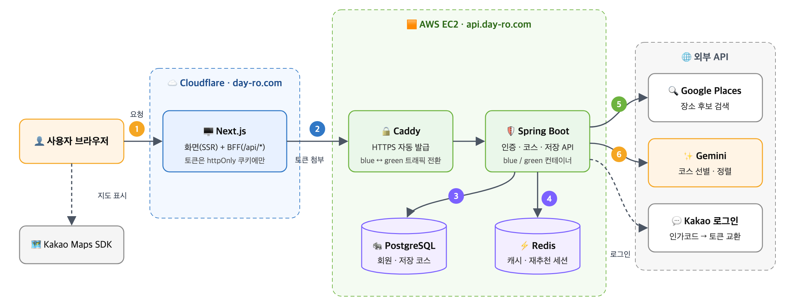

<div align="center">

# 🚕 Dayro

**시간 · 지역 · 목적만 고르면, AI가 오늘의 데이트 코스를 짜주는 웹 서비스**

Google Places로 주변 장소 후보를 모으고 Gemini가 상황에 맞게 골라 순서대로 엮어, 지도와 길찾기까지 한 번에 보여줍니다.

<br>

[🌐 day-ro.com](https://day-ro.com)

<br>


</div>

> [!NOTE]
> 이 저장소는 팀 저장소 `Dayro-dev/dayro`의 **현재 코드 스냅샷 미러**입니다 (커밋 히스토리 제외).

---

## 📑 목차

[프로젝트 현황](#-프로젝트-현황) · [핵심 기능](#-핵심-기능) · [대표 성과](#-대표-성과) · [시스템 구조](#️-시스템-구조) · [기록 문서](#-기록-문서) · [기술 스택](#-기술-스택) · [실행 방법](#️-실행-방법) · [남은 작업](#️-남은-작업)

---

## 📊 프로젝트 현황

<sup>업데이트: **2026-10-13**</sup>

> **운영 배포 v1 완료** — `https://day-ro.com`에서 `로그인 → 상황 입력 → AI 코스 생성·재추천 → 지도·길찾기 → 저장·공유` **전 구간 동작**
>
> **QA 1차 대응 완료** — QA 시트 FE 항목 12건 수정 · 운영 반영 (PR#189)
>
> **남은 작업** — 분석 ID 발급(GA4·Meta) · Gemini 유료 전환 · CSP 강제 모드 전환

| 영역 | 진행 |
| --- | --- |
| 🧩 기능 프로젝트 | **10 / 12 완료** · 2 진행 중 (운영 배포 마무리 · 마케팅 계측) |
| 🔗 머지된 PR | **120+** (FE · BE) |
| 🧪 FE 테스트 | 단위 **788개** (Vitest) · e2e **61개** (Playwright) 통과 |
| 🚀 운영 | FE Cloudflare Workers · BE AWS EC2 블루-그린 무중단 |

### 기능별 상태

| 기능 | 상태 | 파트 | 대표 이슈 · PR |
| --- | --- | --- | --- |
| 카카오 로그인 · 회원 · 탈퇴 | ✅ 완료 | FE | #39·PR#40 / #44 / #90 / #131 / #181 |
| 상황 입력 3단계 | ✅ 완료 | FE | #17 / #48 / #50 / #60 / #69 / #168 / #175 |
| AI 코스 생성 · 다른 코스 보기 | ✅ 완료 | FE | #79 / #85 / #126 / #135 / #143 |
| 코스 결과 · 지도 · 네이버 길찾기 | ✅ 완료 | FE | #54 / #81 / #163 / #185 |
| 코스 저장 · 수정 · 삭제 · 공유 | ✅ 완료 | FE | #75 / #95 / #110 / #113 / #169 / #183 / #187 |
| 마이페이지 · FAQ · 약관 | ✅ 완료 | FE | #37 / #56 / #108 / #177 |
| 프로젝트 기반 · 디자인 시스템 | ✅ 완료 | 공통 | #4 / #6 / #8 / #29 / #133 |
| 성능 최적화 | ✅ 완료 | FE | #97 / #99 / #115 / #119 |
| 보안 점검 · CSP 수집 | ✅ 완료 | FE | #139 / #141 |
| 마케팅 유입 계측 (UTM · GA4 · Meta) | 🟡 진행 중 | FE | #125 (코드 완료, ID 발급 대기) |
| 운영 배포 | 🟡 진행 중 | FE | PR#124 / #146 / PR#159 (운영 중, CSP 강제 전환 남음) |
| AI 에이전트 협업 하네스 | ✅ 완료 | 공통 | #73 / #83 / #103 / #105 |

<sup>범례: ✅ 완료 · 🟡 진행 중 · ⬜ 대기</sup>

---

## ✨ 핵심 기능

1. **상황 입력** — 시간대 · 지역(시·구·동 검색) · 목적 3단계 선택, 생성 대기 중 초성 퀴즈 제공
2. **AI 코스 생성** — Google Places 후보 중 Gemini가 장소를 골라 순서대로 구성, 다른 코스 보기 최대 5회
3. **지도 · 길찾기** — 카카오맵에 코스 동선 표시, 네이버 길찾기(경유지 포함)로 바로 연결
4. **저장 · 공유** — 코스 저장 · 설명 수정 · 삭제, 카카오톡 미리보기 카드("데이로-코스 일정")로 공유
5. **카카오 로그인** — 인가코드 방식 로그인, 로그인 후 이전 화면(상황 입력 단계 포함)으로 복귀

---

## 🏆 대표 성과

| 주제 | 결과 | 기록 |
| --- | --- | --- |
| Cloudflare Workers 이전 | Node 미들웨어 제거로 Worker gzip 3,004KiB → 1,737KiB (-42%) | [06 인프라 · 배포](docs/records/06-infra-deploy.md) |
| 번들 감량 | zod/mini 전환 · 폰트 정리로 라우트 첫 로드 JS 약 -245KB, CI 번들 예산으로 고정 | [04 성능 최적화](docs/records/04-performance.md) |
| 홈 성능 | 개발 환경 LCP 448ms → 124ms, 로딩 화면 CLS(0.159) 제거 | [04 성능 최적화](docs/records/04-performance.md) |
| BE 무중단 배포 | 블루-그린 전환으로 배포 중 502(20~40초) 제거, 전환 중 요청 실패 0건 | [06 인프라 · 배포](docs/records/06-infra-deploy.md) |
| 배포 전 보안 점검 | 토큰 응답 노출 · 경로 조작 · 취약 버전 등 P1~P3 조치 | [05 보안](docs/records/05-security.md) |
| QA 1차 대응 | QA 시트 FE 12건 수정, 항목마다 e2e 시나리오 · 수정 전 실패 확인 | [08 QA 대응](docs/records/08-qa-log.md) |

---

## 🏗️ 시스템 구조

> 브라우저는 Next.js(BFF)만 호출하고, BFF가 쿠키 속 토큰으로 Spring Boot를 대신 호출합니다.

<p align="center"></p>

- **FE** — Next.js 16 App Router + BFF Route Handler, Cloudflare Workers(OpenNext) 엣지 SSR
- **BE** — Spring Boot 3.5 · Spring AI(Gemini) · Google Places, AWS EC2 블루-그린 배포
- **데이터** — PostgreSQL(회원 · 저장 코스) · Redis(외부 API 캐시 · 재추천 세션)
- 자세한 구조 · 레이어 규칙 · 설계 원칙은 [01 아키텍처](docs/records/01-architecture.md)

---

## 📚 기록 문서

> 기능 · 설계 · 개선 작업을 **배경 → 문제 → 해결 → 결과 → 근거** 순서로 남긴 기록입니다. ([문서 안내](docs/records/README.md))

| # | 문서 | 이런 내용을 볼 수 있습니다 |
| --- | --- | --- |
| 01 | [아키텍처](docs/records/01-architecture.md) | 저장소 구조 · 레이어 규칙 · BFF를 둔 이유 · 설계 원칙 |
| 02 | [코스 생성](docs/records/02-course-generation.md) | 후보 수집 → Gemini 선별 → 서버 검증 흐름 · 재추천 · 실패 처리 |
| 03 | [인증 · 로그인](docs/records/03-auth.md) | 인가코드 로그인 · 토큰 보관 · 세션 복구 · 이전 화면 복귀 |
| 04 | [성능 최적화](docs/records/04-performance.md) | 측정 → 개선 → 재측정 기록과 수치 |
| 05 | [보안](docs/records/05-security.md) | 배포 전 점검 P1~P3 · CSP 수집 · 엣지 보안 설정 |
| 06 | [인프라 · 배포](docs/records/06-infra-deploy.md) | Cloudflare Workers 이전 · 블루-그린 배포 · CI 품질 검사 |
| 07 | [구조 개선](docs/records/07-refactoring.md) | 상태 URL 분리 · 컴포넌트 · 훅 역할 분리 |
| 08 | [QA 대응](docs/records/08-qa-log.md) | QA 항목별 원인 · 수정 · 검증 · 결정 기록 |
| 09 | [릴리스 이력](docs/records/09-releases.md) | 운영 반영 이력과 버전 |

---

## 🧱 기술 스택

| 구분 | 기술 | 역할 |
| --- | --- | --- |
| 프론트엔드 | Next.js 16 (App Router) · React 19 · TypeScript | SSR 화면 + BFF Route Handler |
| 검증 | Zod (zod/mini) | BFF ↔ 백엔드 응답 런타임 검증 |
| 지도 | Kakao Maps JavaScript SDK | 코스 동선 표시 |
| 테스트 | Vitest · Playwright · Storybook · Chromatic | 단위 · e2e · UI 카탈로그 · 시각 회귀 |
| 백엔드 | Spring Boot 3.5 · Java 21 · Spring Security(JWT) | 인증 · 코스 · 저장 API |
| AI | Spring AI 1.1 · Google Gemini | 장소 후보 선별 · 코스 구성 (폴백 모델 재시도) |
| 장소 데이터 | Google Places API | 지역별 장소 후보 수집 |
| 데이터 | PostgreSQL 16 + pgvector · Redis 7 | 사용자 · 코스 저장 · 캐시 |
| FE 배포 | Cloudflare Workers · OpenNext | 엣지 SSR · `main` 머지 시 자동 배포 |
| BE 배포 | AWS EC2 · Docker Compose · Caddy · GHCR · SSM | 블루-그린 무중단 배포 · HTTPS 자동 발급 |

---

## ▶️ 실행 방법

### Backend

```bash
cd backend/dayro-backend
cp .env.example .env      # 실제 키는 팀에게 별도로 전달받기
docker compose up -d      # PostgreSQL(pgvector) · Redis
./gradlew bootRun         # http://localhost:8080/health
```

### Frontend

```bash
cd frontend
npm ci
npm run dev               # http://localhost:3000
```

`frontend/.env.local`에 `BACKEND_API_BASE_URL` · `KAKAO_REST_API_KEY` · `NEXT_PUBLIC_KAKAO_MAP_API_KEY` 등 설정

| 명령어 | 용도 |
| --- | --- |
| `npm run test:unit` | 단위 테스트 (Vitest) |
| `npm run test:e2e` | e2e 테스트 (Playwright) |
| `npm run storybook` | 공용 UI 카탈로그 |
| `npm run cf:preview` | Cloudflare Workers 런타임으로 로컬 확인 |

---

## 🗺️ 남은 작업

| # | 작업 | 상태 |
| --- | --- | --- |
| 1 | GA4 · Meta Pixel ID 발급 → 운영 빌드 변수 반영 · 이벤트 확인 | 🟡 진행 중 |
| 2 | Gemini 유료 전환 · 운영 코스 생성 한도 조정 | ⬜ 대기 |
| 3 | CSP 강제 모드 전환 | ⬜ 대기 |
| ✅ | `www` 리다이렉트 · `workers.dev` 비활성화 · HSTS · WAF 요청 빈도 제한 | 완료 |

---

<sub>📐 다이어그램 원본: <code>docs/diagrams/</code> (mermaid <code>.mmd</code> · 아키텍처 <code>.svg</code>) · 📚 기록 문서: <code>docs/records/</code></sub>

<div align="center">
<sub>🤖 프론트엔드는 Claude Code · Codex 두 AI가 동일한 규칙(<code>frontend/AGENTS.MD</code>)으로 역할을 나눠 협업하는 <b>에이전틱 엔지니어링</b> 방식으로 개발했습니다.</sub>
</div>
