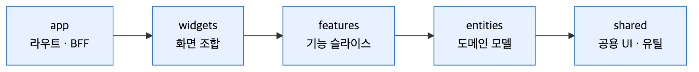

# 01. 아키텍처

> 브라우저는 Next.js(BFF)만 호출하고, BFF가 쿠키 속 토큰으로 Spring Boot를 대신 호출하는 구조입니다.

## 시스템 구성

<p align="center"></p>

1. **브라우저 → Next.js** — 모든 요청을 `day-ro.com`(Cloudflare)으로 전송, 백엔드 주소는 브라우저에 비노출
2. **Next.js → Spring Boot** — BFF가 httpOnly 쿠키의 토큰으로 `api.day-ro.com` 호출, 토큰은 자바스크립트에 비노출
3. **PostgreSQL** — 회원 · 저장 코스 보관
4. **Redis** — 외부 API 응답 캐시 · "다른 코스 보기" 세션(24시간) 보관
5. **Google Places** — 지역 · 목적에 맞는 장소 후보 조회
6. **Gemini** — 후보 중 상황에 맞는 장소 선별 · 방문 순서 정렬

## 결정 — BFF를 둔 이유

- **토큰 보호** — 토큰을 서버에만 두어 XSS로 인한 탈취 방지
- **응답 검증** — 백엔드 응답을 zod로 검증한 뒤 화면에 전달
- **내부 정보 은닉** — 백엔드 주소 · API 키를 브라우저에 노출하지 않음
- **트레이드오프** — 브라우저 요청이 BFF를 한 번 더 거치는 네트워크 홉 추가

## 저장소 구조

```
dayro/
├─ frontend/                  # 🖥️ Next.js 16 — 화면 + BFF
│  └─ src/
│     ├─ app/                 # 라우트 · Route Handler(BFF) · 레이아웃
│     ├─ widgets/             # 여러 feature를 조합한 화면 블록
│     ├─ features/            # 기능 슬라이스 (auth · situation · course-result · course-map · saved · faq …)
│     ├─ entities/            # 공유 도메인 모델
│     └─ shared/              # 공용 UI · API 클라이언트 · 분석 · 유틸
├─ backend/dayro-backend/     # 🛡️ Spring Boot API
│  ├─ src/main/java/com/dayro/
│  │  ├─ auth/                # 카카오 로그인 · JWT
│  │  ├─ situation/           # 지역 · 상황 마스터
│  │  ├─ course/              # 코스 생성 · 재추천 · 저장
│  │  ├─ activity/
│  │  └─ global/              # 보안 설정 · 예외 · 공통 응답
│  ├─ compose.yaml            # 로컬 PostgreSQL(pgvector) · Redis
│  └─ compose.prod.yaml       # 운영 Caddy · backend-blue/green · DB · Redis
└─ .github/workflows/         # ✅ PR 품질 검사 · 백엔드 자동 배포
```

## 레이어 규칙 (Vertical Slice)

<p align="center"></p>

- import 방향은 `app → widgets → features → entities → shared` 한 방향만 허용
- feature 간에는 공개 API(`index.ts`)만 사용, 내부 파일 직접 import 금지
- 화면 조합은 `widgets`, 단일 기능 조각은 `features`, 공용 UI · 유틸은 `shared`
- 서버 전용 코드는 `server/` 폴더 + `server-only`로 클라이언트 번들 유입 차단

## 프론트엔드 설계 원칙

| 원칙 | 내용 |
| --- | --- |
| BFF 경유 | 브라우저의 백엔드 직접 호출 금지, 토큰은 BFF에서만 처리 |
| 런타임 검증 | 백엔드 응답을 zod 스키마로 검증한 뒤 화면에 전달 |
| 서버 상태 우선 | 서버 데이터를 기준으로, 클라이언트는 입력 흐름 · 화면 상태만 관리 |
| 보안 헤더 | CSP(report-only 수집) · HSTS(6개월) · 보호 라우트 세션 검사 |
| 성능 예산 | 라우트별 첫 로드 JS 크기를 CI에서 검사해 회귀 차단 |
| 접근성 | 시맨틱 마크업 · 포커스 관리 · 대비 기준 문서화 |
