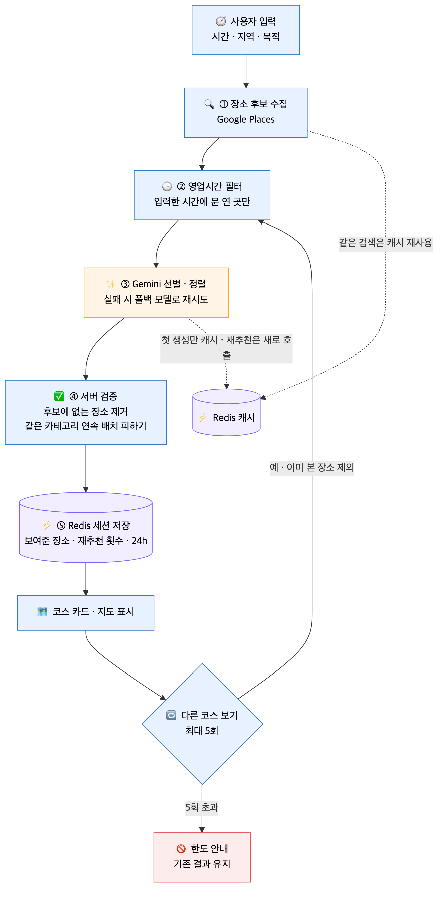

# 02. 코스 생성

> 후보 수집 → 영업 중 필터 → Gemini 선별 → 서버 재검증 순으로 코스를 만들고, 결과는 Redis 세션에 기록합니다.

## 흐름

1. **상황 입력** — 시간대 · 지역(시·구·동) · 목적 3단계 선택, 생성 대기 중 초성 퀴즈 제공
2. **후보 수집** — Google Places로 지역 · 목적에 맞는 장소 후보 조회
3. **필터** — 선택한 시간대에 영업 중인 장소만 유지
4. **선별** — Gemini가 상황에 맞는 장소를 골라 방문 순서대로 정렬
5. **재검증** — 서버가 Gemini 응답을 후보 목록과 대조해 없는 장소 제외
6. **결과** — 장소 선택 → 순서 변경 → 지도 · 네이버 길찾기 · 저장

## 설계 포인트

- **비용 · 속도** — 같은 지역 Places 결과는 Redis 캐시 재사용, 재추천은 Gemini 캐시를 우회해 매번 새 결과
- **할루시네이션 차단** — 후보 목록에 없는 장소 ID는 서버에서 제외
- **장애 대응** — 기본 Gemini 모델 실패 시 폴백 모델로 재시도
- **비로그인 재추천** — `requestId`로 Redis 세션을 조회해 로그인 없이도 "다른 코스 보기" 지원 (최대 5회)
- **이미 본 장소 회피** — 재추천 시 세션에 기록된 장소를 후보에서 제외

## FE 처리 기록

| 주제 | 내용 | 근거 |
| --- | --- | --- |
| 중복 요청 제거 | 로딩 단계 응답을 결과 단계로 넘겨 서버 재요청 1회 제거 | #97 · #99 |
| 재추천 실패 | 실패해도 화면의 기존 코스와 남은 횟수 유지 | #143 |
| 재추천 한도 소진 | 다른 코스 보기 버튼은 유지하고 한도 소진 안내 토스트 | #126 |
| 요청 제한 안내 | 429를 Cloudflare 빈도 제한(10초 후 재시도) · 백엔드 한도(하루 · 재추천) 문구로 구분 | #162 |
| 상태 보관 | 코스 만들기 진행 상태를 URL에서 분리해 흐름 store로 이전 | #129 |
| 최소 선택 완화 | AI 추천이 3곳 이하여도 진행할 수 있도록 최소 선택 4곳 → 1곳 | #163 |
| 길찾기 연결 | 확정 코스를 출발 → 경유지 → 도착 도보 경로로 네이버 지도 연결 | #81 |
