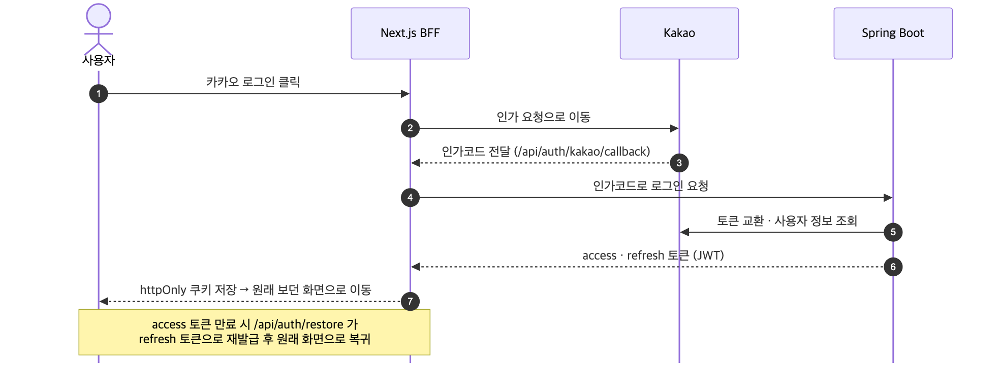

# 03. 인증 · 로그인

> 카카오 인가코드를 BFF가 받아 백엔드에서 토큰으로 교환하고, 토큰은 **httpOnly 쿠키**로만 보관합니다.

## 흐름에서 중요한 지점

- **③ BFF가 콜백을 받는 이유** — 토큰을 주소창 · 자바스크립트에 노출하지 않고 서버에서 바로 쿠키로 저장하기 위함
- **⑦ 이전 화면 복귀 · open redirect 차단** — 로그인 전 경로(`next`)가 내부 경로인지 검증한 뒤에만 복귀

## 토큰 · 세션 정책

- **보관** — access · refresh token 모두 httpOnly · SameSite=Lax 쿠키, 운영은 Secure
- **응답 본문 비노출** — `/api/auth/refresh` 응답 본문에서 토큰 제거 (#139 S1)
- **세션 복구** — access token 만료 + refresh token 존재 시 `/api/auth/restore`에서 갱신 후 원래 경로로 복귀
- **보호 라우트** — 마이페이지 · 찜한 코스는 서버 컴포넌트 가드에서 세션 확인, 없으면 로그인 이동

## 로그인 후 이전 화면 복귀 기록

| 상황 | 문제 | 해결 | 근거 |
| --- | --- | --- | --- |
| 비로그인 코스 저장 → 회원가입 | 상황 입력 1단계로 이동, 입력 · 코스 유실 | 이동 직전 코스 흐름 · 저장 요청을 30분간 보관, 복귀 후 저장 이어서 처리 | #169 (QA #11) |
| 새 탭 · 다른 브라우저로 복귀 | 탭 단위 sessionStorage가 비어 복원 실패 | localStorage 인계(1회 사용 · 30분 만료)로 흐름 복원 | #169 |
| 메뉴에서 로그인 · 로그아웃 | 항상 홈으로 이동 | 현재 경로를 `next`로 전달, 상황 입력 단계는 흐름 상태까지 보관 | #181 (QA #21) |
| 로그인 후 복귀 도입 | 로그인하면 항상 홈으로 이동 · `next`를 통한 open redirect 위험 | 내부 경로만 허용하는 검증을 거쳐 `next`로 복귀 | #131 |
