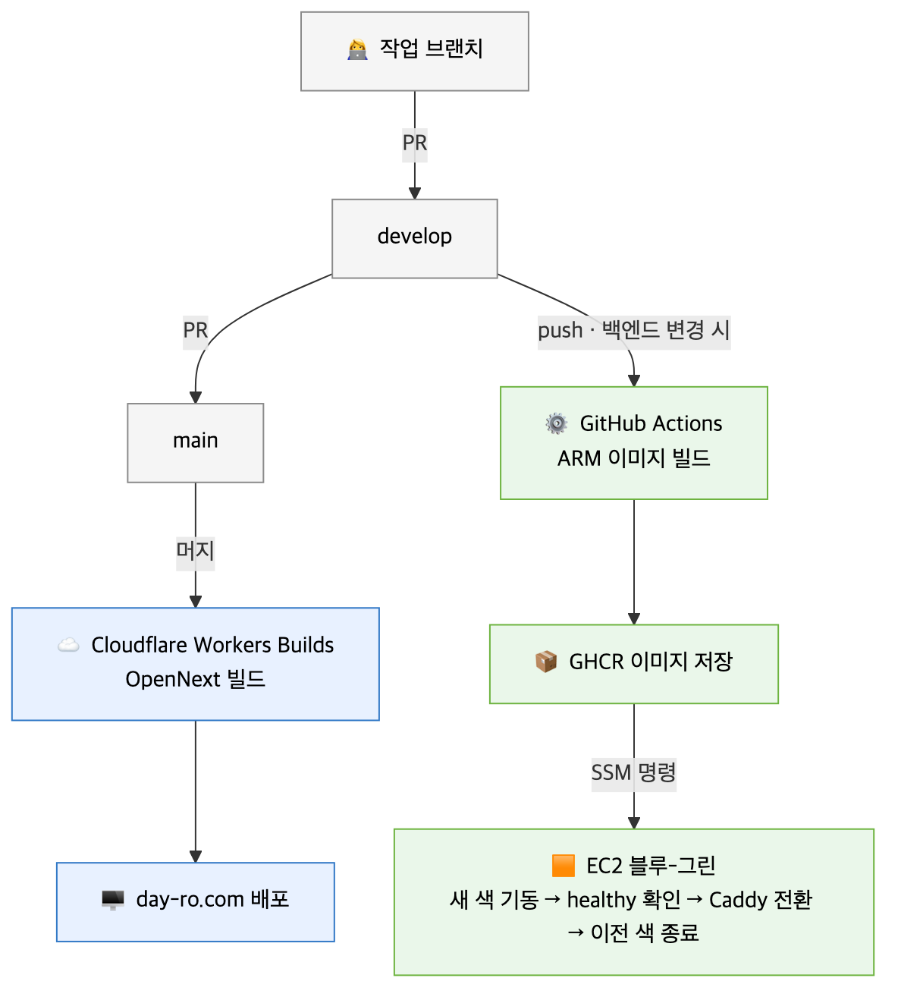

# 06. 인프라 · 배포

| 구성 | 위치 | 배포 방식 |
| --- | --- | --- |
| Frontend (Next.js) | Cloudflare Workers · `day-ro.com` | `main` 머지 → Workers Builds 자동 빌드 · 배포 |
| Backend (Spring Boot) | AWS EC2 · `api.day-ro.com` | `develop` push → GitHub Actions → GHCR → SSM → 블루-그린 전환 |
| HTTPS | Caddy (BE) · Cloudflare (FE) | Let's Encrypt 자동 발급 · 엣지 TLS |
| PostgreSQL · Redis | EC2 Docker Compose | 컨테이너 운영 |

## ① Cloudflare Workers 이전 — Worker 번들 42% 감량 (#146)

- **배경** — FE 운영 배포를 Cloudflare Workers + OpenNext로 구성
- **문제** — Node 미들웨어(`proxy.ts`)가 번들에 포함돼 Worker 크기가 무료 한도의 98% 도달
- **해결** — 미들웨어 제거, 세션 복구를 Route Handler(`/api/auth/restore`) · 서버 컴포넌트 가드로 이전
- **결과** — Worker gzip 3,004KiB → 1,737KiB (-42%), 로컬 Workers 런타임에서 주요 경로 · BFF 동작 확인

## ② BE 블루-그린 무중단 배포 (PR#124)

- **배경** — `docker compose up -d` 교체 방식이라 배포마다 20~40초 502 발생
- **배경** — Docker 기본 종료 대기 10초라 10초 이상 걸리는 코스 생성 요청이 배포 중 끊김
- **해결** — 같은 EC2 안에서 반대 색 컨테이너 기동 → healthy 확인 → Caddy upstream 전환 · reload
- **해결** — 이전 색은 처리 중 요청을 마친 뒤 종료(최대 35초), 실패 시 새 색만 정리하고 기존 색 유지
- **해결** — GitHub Actions가 OIDC 역할로 SSM 명령 실행, 액세스 키 없이 `develop` 머지 → 서버 반영
- **결과** — 로컬 검증 blue → green 전환 중 요청 실패 0건, 실패 경로에서 기존 색 서비스 유지
- **확인 필요** — 10초 이상 요청의 전환 중 유지는 실제 API 키 없이 재현 불가, 설정 · 로그로만 확인

## ③ PR 품질 검사

- `frontend-quality` — lint · build · 라우트 번들 예산 · 품질 가드 테스트 · tsc · Vitest · e2e · Chromatic
- `backend-quality` — `./gradlew build` (Testcontainers 테스트 포함)
- 번들 예산 규칙 · 기준 파일은 [04. 성능 최적화](04-performance.md#회귀-방지) 참고
